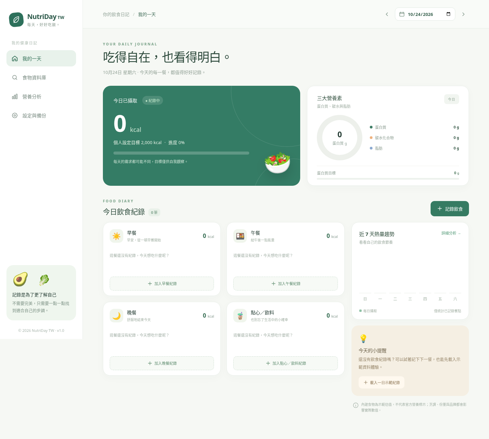

# 🥗 營養茲｜陪你吃好每一天

> 免費、繁體中文、手機友善的每日熱量與營養追蹤網頁 App。**v1.0 可以直接部署 GitHub Pages，完全不需要伺服器、資料庫帳號或 npm 套件。**

## 預覽與功能

- **我的一天**：早餐、午餐、晚餐及點心／飲料；當日熱量與蛋白質／碳水／脂肪；修改、刪除、日期切換。
- **食物資料庫**：25 種台灣常見食物的**示範估值**；搜尋、分類、份數 0.1–100、自訂食物。
- **營養分析**：近 7 天熱量趨勢、記錄日平均熱量、三大營養素換算熱量占比、匯出 CSV。
- **設定與備份**：自訂熱量及蛋白質參考值、JSON 匯出／驗證匯入、清除資料。
- **無帳號設計**：全部個人紀錄存在瀏覽器 `localStorage`，不會由本站上傳到任何伺服器。

⚠️ **請先閱讀**：內建食物數據是用來展示功能的估算範例，**並非官方營養成分資料或確定的品牌標示**。便當、手搖飲與外食熱量差異尤其大。使用者應核對餐點份量、包裝標示或其他可靠資訊。此產品不是醫療／營養專業建議。

## 畫面預覽



[查看手機版操作畫面](docs/screenshots/mobile.png)

## 60 秒啟動（無需 npm install）

需要 Python 3 或任意靜態網頁伺服器：

```bash
python3 -m http.server 5173
```

瀏覽 `http://localhost:5173`。也可以使用 VS Code Live Server。因為使用 ES Modules，不建議直接以 `file://` 雙擊 `index.html`。

## Node.js 測試

```bash
node --test tests/*.test.mjs
```

## 發布到 GitHub Pages

1. GitHub 建立公開 Repository（建議取名 `nutriday-tw`）。
2. 將壓縮檔解壓後的**所有檔案**上傳到 Repository 根目錄，確認根目錄能看到 `index.html`、`src/`、`styles.css`。
3. 打開 **Settings → Pages → Build and deployment → Source: Deploy from a branch**。
4. Branch 選 `main`，資料夾選 `/(root)`，按 **Save**。
5. 網站網址預期為 `https://<你的 GitHub 使用者名稱>.github.io/<儲存庫名稱>/`。Pages 部署完成後即可使用。

因為本專案無建置步驟，直接使用 GitHub Pages 的 branch publishing；**不需 `npm run build`**，也不需要 Vite `base` 設定。部署後，使用者輸入的本機資料不會被提交到 GitHub。

或使用命令列：

```bash
git init
git add .
git commit -m "feat: 營養茲 MVP"
git branch -M main
git remote add origin https://github.com/<USERNAME>/nutriday-tw.git
git push -u origin main
```

## 資料安全

- 使用者輸入的飲食與設定僅在該瀏覽器內儲存。**不支援跨裝置同步**。
- 清除快取／網站資料、無痕模式關閉或更換裝置可能遺失紀錄；**定期備份 JSON**。
- CSV 主要用於外部分析；復原需使用完整 JSON。
- JSON 匯入會先做資料格式驗證，並在覆寫現有資料前再次確認。
- 第三方若架設修改版，請自行審查其網路請求及隱私政策。

## 專案目錄

```text
nutriday-tw/
├── index.html                    # App 入口
├── favicon.svg
├── styles.css                    # 桌機／手機響應式 UI
├── src/
│   ├── app.js                    # 畫面、事件、互動
│   ├── data.js                   # 25 項示範估值食物
│   ├── math.js                   # 日期與營養計算
│   └── storage.js                # 本機保存、驗證與匯入
├── tests/math.test.mjs           # 核心測試
├── docs/產品規格與畫面架構.md        # 需求、畫面與驗收條件
├── package.json                 # 可選擇用 npm test
├── LICENSE                      # MIT
└── README.md
```

## 未來要接真實資料時

台灣衛生福利部食品藥物管理署的 [食品營養成分資料集](https://data.gov.tw/dataset/8543) 可作為後續研究的原始資料來源，需確認其資料使用授權、每 100 克與每份的單位、不同加工及烹調條件、食物分類對照，以及資料更新日期。**目前版本尚未匯入此資料集。**

## 設計／專業原則

- 食物熱量為估計值，生活中不須追求不切實際的精確度。
- 不替使用者自動設定限制性攝取目標。
- 每日熱量、活動與體重關係受多種因素影響，不能只用 1 日數字判斷健康。
- 希望追求更完整的資料品質與多樣性，請看 [`docs/產品規格與畫面架構.md`](docs/產品規格與畫面架構.md)。

## 授權

程式碼 MIT 授權。示範食物數值不得作為官方成分資料引用。
